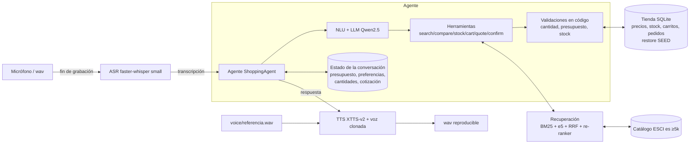

# Laboratorio 4 – Asistente de compras por voz (UTEC · Deep Learning)

Asistente de compras en español que recibe consultas habladas, recupera productos del catálogo
Amazon ESCI (español) con RAG, ejecuta operaciones sobre una tienda simulada (buscar, comparar,
consultar precio/stock, carrito, cotización y pedido) y responde por voz con **clonación de voz**.
Todo corre dentro de Google Colab, sin APIs externas de inferencia.

Notebook principal: **`Laboratorio4_Asistente_Compras_Voz.ipynb`** (generado por `scripts/build_notebook.py`, igual que `Demo_Tienda_Real.ipynb`).

## Entrega

| Qué | Dónde |
|---|---|
| Notebook **ejecutado en Colab (T4)**, con todas las salidas | `Laboratorio4_Asistente_Compras_Voz_ejecutado.ipynb` |
| Notebook limpio para volver a ejecutar | `Laboratorio4_Asistente_Compras_Voz.ipynb` |
| Resultados, 5 aciertos, 5 fallos y limitaciones | **`RESULTADOS.md`** |
| Tablas generadas por el notebook | `results/REPORTE_auto.md`, `results/*.csv`, `results/*.png` |
| Escenarios: audios, transcripciones, operaciones y estado final de la tienda | `results/scenarios/<modo>/<id>/` |
| Calidad de voz, latencia y demo por voz | `results/voice_quality/`, `results/latency/`, `results/voice_demo/` |
| Voz de referencia (voz propia de un integrante) | `voice/referencia.wav` + `voice/referencia.txt` |
| Video explicativo (19:41) | Formulario de entrega |

Los datos ESCI (`data/`) no se versionan: el notebook los descarga en A1.

## 1. Ejecución en Colab paso a paso

1. Comprime la carpeta del proyecto como `purchase.zip` y súbela a `MyDrive/` (o publica el repo y pon su URL en `REPO_URL`).
2. Abre el notebook en Colab → *Entorno de ejecución → Cambiar tipo → GPU T4*.
3. **Parte A · Preparar**: A0 configuración (GPU, código, dependencias, semillas) · A1 datos ESCI (~1 min) · A2 tienda y `restore(SEED)` · A3 graba `voice/referencia.wav` leyendo `voice/referencia.txt` (15–25 s, **tu voz o una voz autorizada**) y los 29 audios de los escenarios (guion en `voice/scripts_lectura.md`); copia `voice/` a `MyDrive/purchase/voice` para conservarlos · A4 carga buscador, LLM, ASR y TTS.
4. **Parte B · Verlo funcionar**: B1 búsqueda · B2 conversación por texto · B3 un turno por voz con su espera real · B4 demo interactiva por voz en Gradio (§11).
5. **Parte C · Medirlo**: C1 nDCG@10 · C2 los 28 escenarios · C3 métricas y errores del ASR · C4 calidad de voz · C5 tiempos · C6 aciertos y fallos · C7 escribe `results/REPORTE_auto.md`.
6. Las funciones auxiliares del notebook están en `shopassist/notebook_utils.py`.
7. La demo opcional con la tienda real está en un notebook aparte: `Demo_Tienda_Real.ipynb`.
8. Los números de la ejecución entregada y el análisis cualitativo están en `RESULTADOS.md`.

Sin GPU (o para depurar) puede usarse `USE_LLM = False` en A4: el agente usa su política basada en reglas.

Pruebas locales (sin modelos pesados): `python -m pytest -q`.

## 2. Versiones

Ver `requirements.txt` (secciones `# core` y `# voz y evaluación`). Probado con Python 3.11/3.12 (Colab),
`torch` preinstalado en Colab (CUDA 12), `faster-whisper 1.1.x`, `coqui-tts 0.27+` (0.26 no instala en Python 3.13, que es el que trae Colab hoy), `speechbrain 1.0.x`, `jiwer 3.x`.
`shopassist/voice.py` y `shopassist/voice_eval.py` incluyen ajustes de compatibilidad para PyAV ≥ 14, torchaudio ≥ 2.9 y huggingface_hub ≥ 1.0.

## 3. Modelos y justificación

| Etapa | Modelo | Por qué |
|---|---|---|
| ASR | `faster-whisper` **small** (float16 GPU / int8 CPU), `language="es"`, `beam_size=5`, VAD | ~1 GB VRAM, RTF ≈ 0.05–0.1 en T4. `medium` reduce algo el WER con ~2× latencia; `large-v3-turbo` (opción) da calidad cercana a large-v3 con ~1.6 GB. |
| LLM | `Qwen/Qwen2.5-3B-Instruct` fp16 (alternativa `Qwen2.5-7B-Instruct` en 4 bits) | Buen español y salida estructurada; cabe junto a la voz. El control y las validaciones se hacen en código. |
| Embeddings | `intfloat/multilingual-e5-small` | Multilingüe, búsqueda asimétrica, rápido de indexar (5k productos < 1 min). |
| Re-ranker | `cross-encoder/mmarco-mMiniLMv2-L12-H384-v1` | Cross-encoder multilingüe; sólo top-50. |
| TTS | Coqui **XTTS-v2** (`tts_models/multilingual/multi-dataset/xtts_v2`, `coqui-tts`) | Clonación *zero-shot* en español con 6–30 s; latentes del hablante precalculados una vez (`get_conditioning_latents`). Licencia **CPML: uso no comercial/académico**. Alternativa documentada: F5-TTS en español (más lenta, requiere transcripción de la referencia). |
| Similitud de voz | SpeechBrain ECAPA `speechbrain/spkrec-ecapa-voxceleb` | Embeddings de hablante estándar para coseno; sólo en evaluación. |

### Presupuesto de memoria (T4, 15 GB utilizables)

| Componente | VRAM aprox. |
|---|---|
| Qwen2.5-3B fp16 (o 7B 4-bit) | 6.5 GB (≈ 5.5 GB) |
| KV-cache / activaciones LLM | 0.5–1 GB |
| faster-whisper small fp16 | 1.0 GB |
| XTTS-v2 | 2.0 GB |
| e5-small + re-ranker | 1.0 GB |
| ECAPA (evaluación) | 0.1 GB |
| **Total** | **≈ 11–11.5 GB** |

Se mide en el notebook con `torch.cuda.memory_allocated()` y `free -h` tras cada carga. Si falta memoria:
`cfg.llm_4bit=True`, ASR en `int8_float16`, o liberar el re-ranker con `free_memory()`.

## 4. Arquitectura



Módulos: `shopassist/config.py`, `data.py`, `store.py`, `retrieval.py`, `evaluation.py`, `attributes.py`,
`state.py`, `nlu.py`, `tools.py`, `llm.py`, `agent.py` (núcleo) y `voice.py`, `latency.py`,
`voice_eval.py`, `scenarios.py` (voz, latencia, evaluación de voz y escenarios).

## 5. Escenarios

`scenarios/scenarios.yaml`: **22 escenarios por texto + 6 por voz** (28). Cada uno parte de `store.restore(SEED)` y
*hooks* reproducibles que referencian posiciones (no IDs): `set_stock_last_result`, `set_stock_cart_item`,
`set_stock_query`. Las comprobaciones (`order_count`, `no_duplicate_orders`, `cart_total_le_budget`,
`clarification_asked`, `qty_of_item`, `budget_preserved`, `alternative_proposed`, `no_order`,
`stock_consistent`, `reply_contains_any`, `op_called`, `op_not_called`, `cart_qty_le_stock`, `cart_empty`, `any_of`)
se evalúan sobre el registro de operaciones y el estado real de la tienda. Además, en todos los escenarios se
cuentan las **violaciones**: presupuesto superado, stock negativo, pedido sin confirmación y pedidos duplicados.
Las consultas son pedidos genéricos (audífonos, funda, cargador, botella, cuaderno, pilas, mochila, ratón):
**no se usan las consultas de test de ESCI**.

Voz (v1–v6, 5 multi-turno): compra confirmada, aclaración, cambio de cantidad, agotado, corrección de transcripción,
cambio de stock entre cotización y confirmación + reconfirmación sin duplicar. Se ejecutan con audio→ASR y se
repiten con la transcripción correcta (`gold_transcript`). Resultados por escenario en
`results/scenarios/<modo>/<id>/` (`result.json`, `ops.json`, `final_store.json`, `transcripts.txt`, audios).

## 6. Requisito del PDF → dónde se cumple

| Requisito (Laboratorio_4.pdf) | Dónde |
|---|---|
| Consultas habladas en español (ASR) integradas en la conversación | `shopassist/voice.py` (`ASR`), `latency.py` (`VoicePipeline`), notebook A3, B3 |
| RAG sobre el catálogo; recomendaciones sustentadas en lo recuperado | `retrieval.py`, `tools.py` (`search_products`, `get_product_details`), notebook B1, B2 |
| Atributos no verificables tratados como desconocidos | `attributes.py`, `store.get_product` ("desconocido"), escenario `t06_atributo_desconocido` |
| Buscar, comparar, precios y existencias, cotización, pedido tras confirmación | `tools.py`, `agent.py`, `store.py`; escenarios t01–t05, t20 |
| Conservar cantidades, presupuesto y preferencias; aclaraciones y cambios de decisión | `state.py`, `agent.py`; escenarios t07–t09, t16, t17, v2, v3 |
| Stock cambia antes de confirmar → detectar y proponer alternativa | `store.place_order` (re-validación), `find_alternative`; escenarios t14, v6 |
| Dataset ESCI es reducido (*small*), catálogo ≥ 5 000 con títulos, descripciones, atributos e ids | `data.py` (`prepare_data`, `check_data`), notebook A1 |
| ≥ 200 consultas de evaluación con todos sus productos anotados en el catálogo; split por `query_id` train/test | `data.py`, `check_data` (`all_annotated_in_catalog`), notebook A1 |
| Tienda simulada (precios, existencias, carritos, pedidos) con semilla fija y restaurable | `store.py` (`restore`), notebook A2 (hash de reproducibilidad) |
| Etiquetas ESCI sólo para evaluar/ajustar con train; no consultables por el agente | `data.load_data` (qrels separados), `evaluation.py`; el agente sólo recibe catálogo + tienda |
| Agente que selecciona operaciones según la solicitud y los resultados | `agent.py`, `tools.py`, `llm.py`; registro `ops` en cada turno |
| Mantener estado y pedir aclaraciones ante falta de información o ambigüedad | `state.py`, `nlu.py`, `ask_clarification`; t07, t08, v2 |
| Validar cantidades, presupuesto y stock en código; al confirmar re-comprobar, sin cambios parciales ni duplicados | `store.create_quote`/`place_order` (transacción atómica, idempotencia), `tests/`; t03, t14, t15, t18, t21, v6 |
| Respuestas habladas con voz propia/autorizada a partir de grabación de referencia | `voice.py` (`TTS`, XTTS-v2), `voice/referencia.wav`, notebook A3, B3 |
| Textos generados distintos de los de la referencia | `voice/referencia.txt` (texto neutro), guarda `TTS._check_text` / `text_overlaps_reference` |
| Comparar con modelo base léxico y ablación sobre un componente, mismas consultas | `evaluation.run_retrieval_experiments` (BM25 vs. híbrido+re-ranker; sin re-ranker, sin denso, sólo título), notebook C1 |
| Modelos preentrenados; recuperación, control, memoria, herramientas y validaciones propios | BM25 propio, RRF, agente, estado, herramientas y validaciones en `shopassist/` |
| Todo en Colab, sin APIs externas; justificar modelos y gestionar memoria | §3 de este README, `config.py`, notebook A0 y A4 (`memory_report`) |
| ≥ 20 escenarios operativos con estados iniciales reproducibles | `scenarios/scenarios.yaml` (28), `scenarios.py` (`run_scenario`, `run_all`), notebook C2 |
| 6 escenarios por audio (compra confirmada, ambigua, cambio, agotado, corrección de transcripción, stock entre cotización y confirmación + reconfirmación) | v1–v6 en `scenarios.yaml`, guion `voice/scripts_lectura.md` |
| ≥ 3 pruebas de voz con varias intervenciones | v1, v2, v3, v4, v5, v6 son multi-turno (2–10 turnos) |
| Conservar audios, transcripciones, operaciones y estado final de la tienda | `results/scenarios/<modo>/<id>/` |
| Repetir los casos de voz con la transcripción correcta para identificar errores del ASR | `run_all(..., input_mode="gold_transcript")`, `compare_voice_vs_gold`, notebook C2 |
| nDCG@10 con ganancias E=1, S=0.1, C=0.01, I=0 | `evaluation.ndcg_at_k`, `data.GAINS`, notebook C1 |
| % de escenarios correctos e incumplimientos de restricciones | `scenarios.scenario_metrics`, notebook C3 |
| Errores de transcripción en cantidades, importes y productos | `voice_eval.asr_error_analysis` / `summarize_asr_errors`, notebook C3 |
| Inteligibilidad y semejanza con la voz de referencia | `voice_eval.evaluate_voice_quality` (WER/CER Whisper, coseno ECAPA vs. voz de fábrica), notebook C4 |
| Tiempo desde fin de grabación hasta audio reproducible, por etapa; carga inicial vs. consultas posteriores | `latency.py` (`VoicePipeline`, `load_models`, `latency_summary`, `plot_latency`), notebook A4, B3, C5 |
| No ajustar con las consultas de evaluación | `tune_hybrid` sólo usa `train`; escenarios con consultas genéricas |
| Entrega: notebook Colab con datos, índice, restauración, voz, agente, memoria, herramientas, validaciones, evaluación base/ablación, pruebas | `Laboratorio4_Asistente_Compras_Voz.ipynb` partes A–C |
| Instrucciones de ejecución, versiones, modelos y configuración | este README (§1–§3), `requirements.txt`, `config.py` |
| Gráficos y resultados en el notebook o Markdown | notebook C1, C3–C5; `results/*.png`, `results/REPORTE_auto.md` |
| Analizar ≥ 5 aciertos y ≥ 5 fallos, causas y limitaciones | notebook C6, plantilla §8 de este README |
| Video ≤ 20 min (metodología 4, implementación 4, demo 8 con voz y espera real, resultados 4) | §10 de este README (guion) |

## 7. Qué debe hacer el estudiante manualmente

1. Grabar `voice/referencia.wav` con su propia voz (o autorizada) leyendo `voice/referencia.txt`.
2. Grabar los 29 audios de `voice/scripts_lectura.md` (`voice/scenarios/v{n}_t{k}.wav`).
3. Ejecutar el notebook completo en Colab con GPU y copiar los resultados a la plantilla (§8).
4. Grabar el video siguiendo el guion de la §10 de este README.

## 8. Plantilla de reporte de resultados

El notebook escribe `results/REPORTE_auto.md` con todas las tablas calculadas. Para la entrega, copia
los valores en esta plantilla (puede vivir en un `REPORTE.md` aparte) y completa el análisis.

**Configuración**: GPU {{gpu}} · semilla {{seed}} · LLM {{llm}} · ASR faster-whisper {{asr_size}} · TTS XTTS-v2 ·
catálogo {{n_productos}} · consultas train/test {{n_train}}/{{n_test}}.

**Recuperación (nDCG@10)**

| Sistema | train | test | IC95 test |
|---|---|---|---|
| BM25 (baseline) | | | |
| Denso e5 | | | |
| Híbrido RRF (ablación: sin re-ranker) | | | |
| BM25 + re-ranker (ablación: sin denso) | | | |
| BM25 sólo título (ablación: texto) | | | |
| **Híbrido + re-ranker (sistema)** | | | |

**Escenarios**

| Modo | Escenarios | Correctos | % | Presup. superado | Stock negativo | Pedido sin confirmación | Duplicados |
|---|---|---|---|---|---|---|---|
| Texto | 28 | | | | | | |
| Voz (audio) | 6 | | | | | | |
| Voz (transcripción correcta) | 6 | | | | | | |

**Voz** — ASR: WER {{}} · CER {{}} · errores en cantidades {{}}/{{}} · importes {{}}/{{}} · productos {{}}/{{}}.

| Voz sintetizada | WER | CER | Similitud con la referencia |
|---|---|---|---|
| Clonada (XTTS-v2) | | | |
| Hablante de fábrica XTTS (línea base) | | | |
| Mitad vs. mitad de la referencia (cota) | – | – | |

**Latencia (s)**

| Fase | ASR | Recuperación | LLM | Herramientas | TTS | Total |
|---|---|---|---|---|---|---|
| Carga inicial | | | | | | |
| Primer turno | | | | | | |
| Posteriores (media / p90) | | | | | | |

**5 aciertos y 5 fallos** (recuperación y escenarios): caso, resultado, causa.
**Limitaciones**: ver notebook C6.

## 9. Demo extra (opcional): tienda real soyHouston256/store

> **No es la evaluación oficial.** La evaluación del laboratorio sigue siendo la del PDF: catálogo ESCI ≥ 5k,
> tienda simulada `Store`, `scenarios/scenarios.yaml` y métricas de las partes A–C del notebook. Esta demo
> no cambia ni los datos ni los resultados oficiales.

`shopassist/remote_store.py` añade `RemoteStoreAdapter`, un backend con la **misma interfaz que `Store`**
(subclase: reutiliza carritos, cotizaciones, idempotencia y la confirmación atómica) que permite al mismo agente
comprar en la tienda real de merch (polos, tazas y mousepads):

* **Catálogo y precios** desde `GET {STORE_API_URL}/api/products` (moneda `Config.remote_store_currency`, por defecto PEN).
  Se convierte a un DataFrame con el esquema de ESCI (texto en español: tipo, diseño, colores, tallas, corte) y se indexa con BM25.
* **Stock simulado**: la API solo tiene `soldOut`; el stock numérico vive en la sombra SQLite (semilla reproducible, `restore`; `soldOut` → 0).
* **Revalidación real**: antes de confirmar se relee cada producto con `GET /api/products/:id`; si cambió el precio o está agotado, se rechaza y el agente re-cotiza o propone alternativa.
* **Variantes**: el agente pide talla / color / corte si faltan y los envía en el pedido (`size`, `color` hex tal como lo da la API, `cut`).
* **Pedidos en DRY-RUN por defecto**: se registra en local y se guarda el payload de `POST /api/orders`. Solo con
  `allow_real_orders=True` **y** `customer={"dni","name","phone"}` se crea un pedido real; nunca se hace POST dos veces para la misma cotización (tabla `remote_orders`).

```python
import os; os.environ["STORE_API_URL"] = "https://api.<dominio>"   # sin URL: copia offline (scenarios/tienda_real_fixture.json)
from shopassist.remote_store import build_remote_demo
from shopassist.scenarios import load_scenarios, run_all
demo = build_remote_demo(cfg)                     # dry-run
df, res = run_all(load_scenarios("scenarios/scenarios_tienda_real.yaml"), demo["agent_factory"], demo["store"])
```

Escenarios: `scenarios/scenarios_tienda_real.yaml` (polos de Redis talla M negros, «quiero un polo» ambiguo, polo
agotado, taza). Pruebas sin red: `tests/test_remote_store.py` (API falsa `FakeTransport`). Notebook: `Demo_Tienda_Real.ipynb`.

## 10. Guion para el video (máx. 20 min)

**Metodología (4 min)** – Problema y arquitectura (diagrama de la §4): ASR → agente (estado + herramientas + RAG) → TTS. Decisiones: modelos pequeños para caber en una T4, validaciones en código (no en el LLM), cotización congelada + confirmación idempotente, eco "Entendí… ¿es correcto?" para entradas de voz. Datos: ESCI es, catálogo ≥ 5 000, split por `query_id`.

**Implementación (4 min)** – Recuperación (BM25 propio, e5, RRF, re-ranker; ajuste solo en train). Agente: selección de herramientas, memoria de conversación, aclaraciones, atributos desconocidos. Tienda: SQLite, transacciones atómicas, `restore(SEED)`. Gestión de memoria: tabla de VRAM (notebook A4), carga perezosa, `memory_report`.

**Demostración (8 min)** – En vivo con voz desde la demo Gradio de B4 (guion detallado en la §11): (1) compra completa con presupuesto que termina en pedido confirmado (mostrar **una interacción completa con su espera real**, cronómetro de la sección B3); (2) caso de aclaración o recuperación: producto agotado o cambio de stock entre cotización y confirmación + reconfirmación sin duplicar. Mostrar carrito, pedido y stock final.

**Resultados (4 min)** – Tabla nDCG@10 BM25 vs. sistema y ablaciones (C1); % escenarios, incumplimientos, errores ASR en cantidades/importes/productos (voz vs. transcripción correcta, C2–C3); inteligibilidad y similitud de voz (C4); latencia por etapa fría vs. caliente (C5); 5 aciertos/5 fallos y limitaciones (C6).

## 11. Demo interactiva (Gradio)

Celda **B4** del notebook. Usa los modelos ya cargados en A4 y el mismo `VoicePipeline` cronometrado de B3
(`shopassist/latency.py`); la interfaz está en `shopassist/demo_ui.py` (`build_demo`).

**Cómo lanzarla**

1. Ejecuta A0–A4 en Colab con GPU (y B2/B3 si quieres; B4 solo necesita `store`, `retriever`, `llm`, `asr`, `tts`, `cfg` y `ShoppingAgent`).
2. Ejecuta B4: instala `gradio` si falta, hace `store.restore(SEED)` y lanza `demo.launch(share=True)`.
   Abre el enlace `https://….gradio.live` (el micrófono del navegador necesita HTTPS; el enlace público lo es).
3. Graba con el micrófono: al **detener la grabación** el turno se envía solo (o pulsa *Enviar*).
   El cuadro de texto es un respaldo que omite el ASR.
4. Para detenerla: `demo.close()`. La tienda es la de A2 (SQLite en memoria), así que *Reiniciar sesión* con
   «restaurar la tienda» solo vuelve al estado de `restore(SEED)`; no toca ningún archivo.

Qué muestra cada turno: transcripción y respuesta en el chat, audio de respuesta con reproducción automática,
**espera real** (el contador de Gradio sobre las salidas mientras se procesa y, al terminar, el tiempo medido por
etapa: ASR, recuperación, LLM, herramientas, TTS y total, desde el fin de la grabación hasta el wav listo), la tabla de
latencia de todos los turnos, el carrito, los pedidos de la sesión y el stock de los productos relevantes, leídos de la tienda.
Las grabaciones y respuestas quedan en `results/gradio_demo/<sesión>/`. Las peticiones se atienden de una en una
(`default_concurrency_limit=1`) porque comparten la GPU.

**Guion sugerido (8 min)** — en la ejecución entregada cada turno caliente tarda ≈ 11 s de media (p90 ≈ 15 s, §4 de `RESULTADOS.md`); el primero, algo más.

| Min | Qué hacer | Qué decir/mostrar |
|---|---|---|
| 0:00–0:45 | Pulsa *Reiniciar sesión* con «restaurar la tienda» marcado | Tienda en el estado de `restore(SEED)`, carrito y pedidos vacíos |
| 0:45–4:30 | **(a) Compra completa por voz**: «Busco una botella de agua, mi presupuesto es de cuarenta euros» → «Añade dos unidades del primero al carrito» → si el agente repite «Entendí: … ¿Es correcto?», responde «Sí, es correcto» → «Prepara la cotización» → «Sí, confirmo el pedido» | Deja que **al menos un turno se vea entero sin cortar**: fin de grabación → contador de Gradio → audio de respuesta. Luego lee el desglose por etapa (ASR, LLM, TTS…). Al confirmar aparece el pedido y baja el stock |
| 4:30–5:15 | Repite «Sí, confirmo el pedido» | Confirmación idempotente: devuelve el mismo pedido, no crea otro |
| 5:15–7:00 | **(b) Aclaración**: *Reiniciar sesión* (sin restaurar la tienda, para conservar el pedido) → «Añade eso al carrito» → «Busco audífonos bluetooth» | Sin contexto el agente no añade nada y pregunta a qué producto te refieres (escenario v2, correcto con audio y con transcripción); el carrito sigue vacío |
| 7:00–8:00 | **(c) Estado final** | Panel de pedidos (pedido de (a), uno solo), stock reducido del producto comprado, carrito y tabla de latencias por turno |

Se recomienda el caso de **aclaración** y no el de recuperación: en la ejecución entregada v2 (aclaración) es
correcto, mientras que v4 (agotado) y v5 (corrección de transcripción) fallan con el LLM (§6 de `RESULTADOS.md`).
Como el LLM no es determinista, ensaya el guion antes de grabar; si una respuesta se desvía, *Reiniciar sesión* y repetir.
